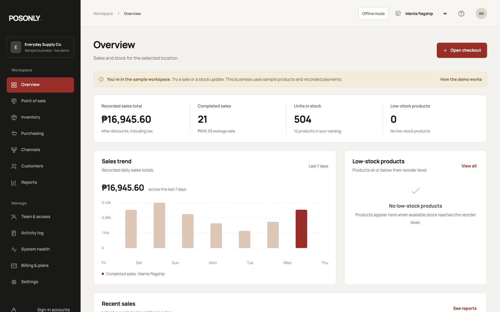
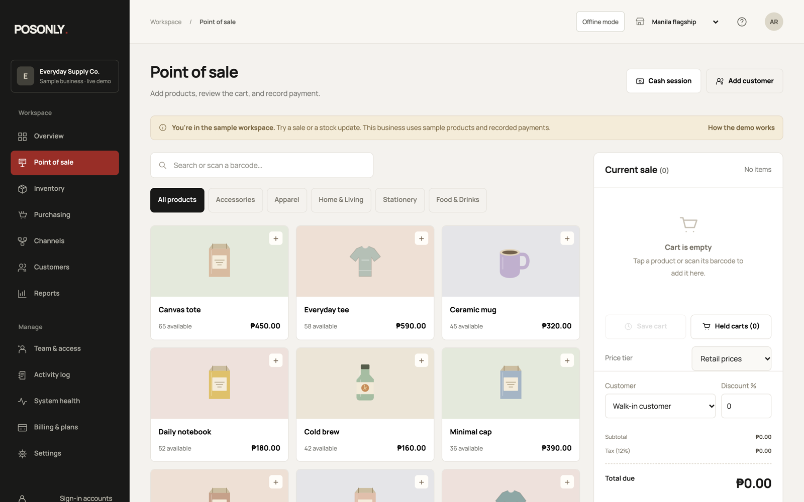
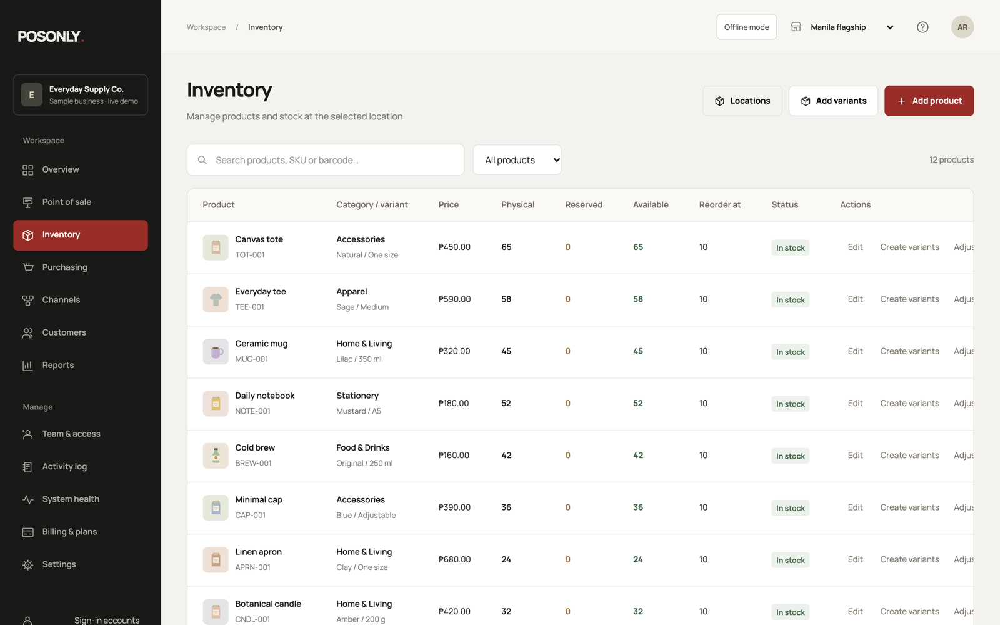
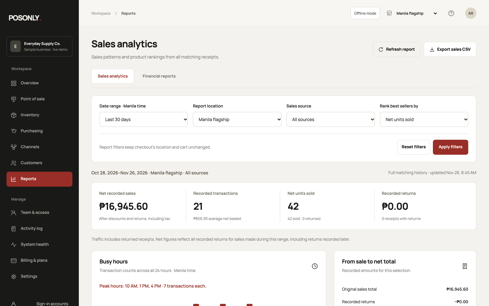
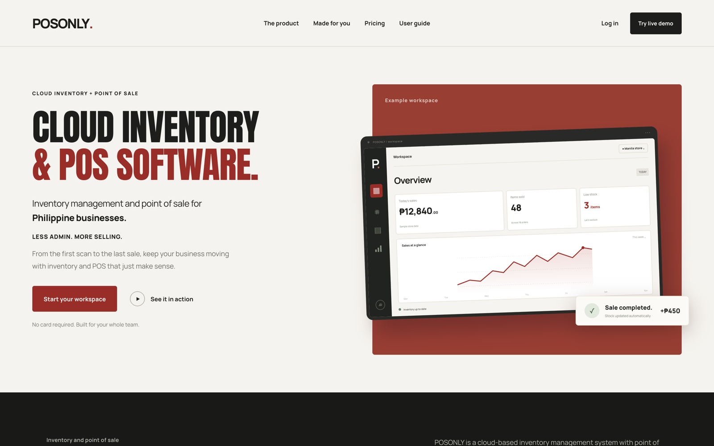
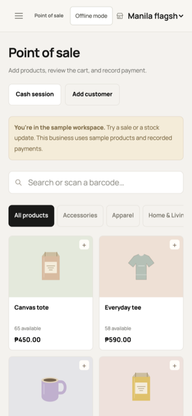
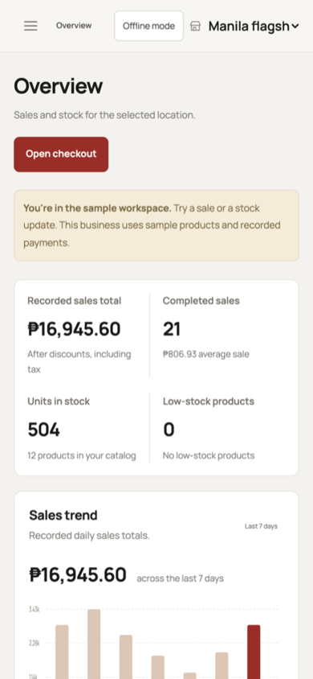

# POSONLY: Cloud Inventory & POS for Philippine Businesses


POSONLY is a cloud inventory and point-of-sale system for small shops in the Philippines. Staff can sell at the counter, receive supplier deliveries, count and transfer stock across locations, and review sales. It runs in the browser, works offline for cash sales, and comes with an Android and iPhone app.



## Highlights

- **Every business is isolated.** Each company's products, stock, staff, and sales are scoped to it on every request.
- **Stock can't be oversold.** Deductions are conditional SQL updates that respect units reserved for online orders, so two tills can't sell the same last item.
- **Checkout is safe to retry.** A dropped connection or a double tap returns the original sale. Reusing a checkout key for a different cart is refused.
- **Cash sales work offline.** A device-cached catalog and an offline queue keep the till running. Each sale stays provisional until the server confirms it.
- **Native mobile app.** An Expo/React Native app with barcode scanning, cash POS, and encrypted on-device storage.
- **Real subscription billing.** PayMongo hosted checkout with signed, replay-safe webhooks, plus trials, plan limits, and invoices.

## Features

**Point of sale**
- Product grid with category filters, barcode search and scanning, and retail or wholesale price tiers
- Discounts, configured tax, and cash, card, e-wallet, or split tenders, all calculated on the server
- Printable, branded receipts; held carts that re-check price and stock when resumed
- Optional cash sessions with an opening float, cash in/out, an immutable closing count, and variance
- Partial and full returns priced from the original receipt

**Inventory and purchasing**
- SKUs, barcodes, categories, costs, and low-stock thresholds per location
- Size/colour product families that generate up to 100 sellable SKUs in one batch
- Physical, reserved, and available stock tracked separately at every location
- Supplier purchase orders with approval, partial receiving, and receipt history
- Replenishment rules that draft purchase orders while accounting for stock already on order

**Reports and administration**
- Sales analytics in Manila time: hourly traffic, peak hours, and top 10 SKUs by units or sales
- Financial reports by day, location, source, and tax rate, with margin from cost snapshots and CSV export
- Administrator, manager, and cashier roles enforced by the backend
- Activity log, a system health page, and sanitized error monitoring

**Platform**
- Versioned mobile API with revocable, role-scoped Sanctum device tokens
- Subscription plans, trials, staff and location limits, and invoice history
- Google sign-in, password recovery, and an SEO-ready marketing site with a searchable staff guide

## Screenshots

| Point of sale | Inventory |
| --- | --- |
|  |  |
| **Sales analytics** | **Landing page** |
|  |  |

<p align="center">
  
  &nbsp;&nbsp;
  
</p>

## Tech stack

| Layer | Choice |
| --- | --- |
| Web backend | PHP 8.3+, Laravel 13, Sanctum |
| Web frontend | Blade with hand-written CSS and JavaScript served from `public/` (no build step) |
| Offline | Service worker, device catalog cache, signed snapshot periods, cash-only outbox |
| Mobile | Expo SDK 57, React Native 0.86, Expo Router, SecureStore, SQLCipher-encrypted SQLite |
| Database | SQLite locally, MySQL 8 in the supplied production stack |
| Payments | PayMongo hosted checkout for subscription invoices |
| Deployment | Docker image (PHP 8.4 + Apache) or conventional PHP hosting with queue and scheduler scripts |
| Quality | 1,300+ PHPUnit tests, Laravel Pint, TypeScript, ESLint, and Node tests for the mobile app |

## Getting started

### Prerequisites

- PHP 8.3+ with `pdo_sqlite`, `bcmath`, `intl`, and `mbstring`
- Composer 2

No Node.js is needed for the web app. The mobile app has its own requirements, covered in [Mobile app](#mobile-app).

### Install and run

```bash
git clone https://github.com/pewbbs/POS-ONLY-Inventory-POS-VERSION-2.git posonly
cd posonly
composer install
cp .env.example .env
php artisan key:generate
touch database/database.sqlite
```

To get a sample business to explore, open `.env` and set:

```dotenv
DEMO_ENABLED=true
```

Then migrate, seed, and start the server:

```bash
php artisan migrate --seed
php artisan serve --port=8010
```

Open <http://127.0.0.1:8010> and click **Try live demo**. You'll be signed in to *Everyday Supply Co.*, a sample business with three locations, a product catalog, staff, and recent sales. Demo accounts use random passwords, so there are no shared credentials. You can also register a new, empty business.

The demo entry only works when `APP_ENV=local`. Never enable it or seed demo data in production.

### Background work

Low-stock checks and diagnostics run on the queue, and renewals and alerts run on the scheduler. Start each one in its own terminal:

```bash
php artisan queue:work --tries=3
```

```bash
php artisan schedule:work
```

### Tests and formatting

```bash
php artisan test
vendor/bin/pint --test
```

## Mobile app

`mobile/` contains the Android and iPhone app. It signs in with a company account and covers inventory, barcode scanning, cash POS, receipts, and an offline cash outbox that syncs on reconnect. Device tokens live in the platform keychain, and the local catalog and queue are stored in SQLCipher-encrypted SQLite.

```bash
cd mobile
npm ci
npm run typecheck && npm run lint && npm test
```

The encrypted database needs a development or release build (`npm run android` / `npm run ios`). Expo Go isn't supported. See the [technical reference](docs/TECHNICAL_REFERENCE.md#android-and-iphone-app) for device testing and end-to-end checks.

## How it's built

A few patterns carry most of the weight. Every excerpt below is from the codebase.

### Stock deductions that respect reservations

Stock isn't read, checked, and then written, which would let two requests race. The decrement is a single conditional `UPDATE` that only succeeds if enough units remain after online reservations. If no row changes, the sale is refused with a clear message.

```php
// app/Services/InventoryService.php
if ($quantity < 0) {
    $updated = Stock::whereKey($stock->id)
        ->whereRaw('quantity >= reserved_quantity + ?', [abs($quantity)])
        ->decrement('quantity', abs($quantity));

    if ($updated !== 1) {
        $stock->refresh();
        $available = max(0, $stock->quantity - $stock->reserved_quantity);
        throw ValidationException::withMessages(['items' => "{$product->name} has {$available} available units. ..."]);
    }
}
```

Every change also writes a `StockMovement` record. The surrounding transaction retries up to five times on deadlock.

### Idempotent checkout with request fingerprints

Each checkout carries an idempotency key and a SHA-256 hash of its canonical contents. Replaying the same request returns the original sale. Reusing the key with a different cart or payment fails with `409` instead of silently returning the wrong receipt.

```php
// app/Services/InventoryService.php
$requestHash = hash('sha256', json_encode($canonical, JSON_THROW_ON_ERROR));

return DB::transaction(function () use ($user, $data, $requestHash /* ... */): Sale {
    $tenant = Tenant::whereKey($user->tenant_id)->lockForUpdate()->firstOrFail();
    $existing = Sale::where('tenant_id', $user->tenant_id)
        ->where('idempotency_key', $data['idempotency_key'])
        ->first();

    if ($existing) {
        $sameRequest = hash_equals($existing->request_hash, $requestHash)
            || (/* requests recorded before price tiers existed */);
        abort_unless($sameRequest, 409, 'This checkout key was already used for a different transaction.');

        return $existing->load(['cashier', 'returns.actor']);
    }
    // ... price, tax and stock are recalculated on the server
});
```

### Verified, replay-safe payment webhooks

PayMongo webhooks are checked before anything is trusted. The signature header must parse strictly, the timestamp must be fresh, and the HMAC is compared in constant time against the secret for the current mode (test or live). Duplicate deliveries are deduplicated by event key and payload digest.

```php
// app/Services/PayMongoWebhookService.php
$modeField = $mode === 'live' ? 'li' : 'te';
if (! isset($fields['t'], $fields[$modeField])
    || preg_match('/\A[0-9]{10}\z/D', $fields['t']) !== 1
    || preg_match('/\A[a-f0-9]{64}\z/Di', $fields[$modeField]) !== 1) {
    return false;
}
$tolerance = max(1, min(300, (int) config('paymongo.webhook_tolerance_seconds', 300)));
if (abs(now()->timestamp - (int) $fields['t']) > $tolerance) {
    return false;
}

return hash_equals(hash_hmac('sha256', $fields['t'].'.'.$body, $secret), strtolower($fields[$modeField]));
```

## Project structure

```
app/
├── Http/Controllers/   Web workspace, mobile API, billing, webhooks, reports
├── Services/           Domain logic: inventory and checkout, returns, cash sessions,
│                       offline sales, replenishment, analytics, billing, monitoring
├── Models/             Eloquent models (business data carries a tenant_id)
└── Jobs/               Queued low-stock checks, webhook processing, diagnostics
mobile/                 Expo / React Native app for Android and iPhone
public/                 Hand-written CSS/JS, service worker, offline page
resources/views/        Blade templates for the workspace and marketing site
deploy/                 Apache, Docker Compose, and shared-hosting scripts
tests/                  Feature and unit suites
docs/                   Staff guide, deployment guide, technical reference
```

## Documentation

- [Staff guide](docs/USER_GUIDE.md): day-to-day use for cashiers and managers
- [Deployment](docs/DEPLOYMENT.md): production configuration, Docker, and conventional hosting
- [Technical reference](docs/TECHNICAL_REFERENCE.md): billing, offline mode, mobile API, implemented scope, and integration boundaries

## Author

Built by **Pablito Torres** ([@pewbbs](https://github.com/pewbbs)).
